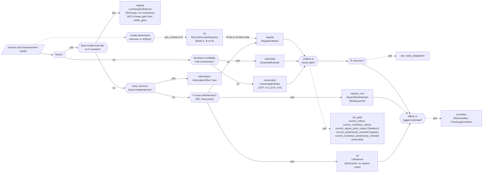
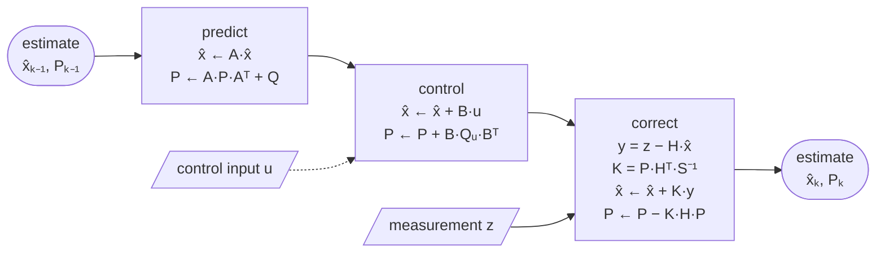
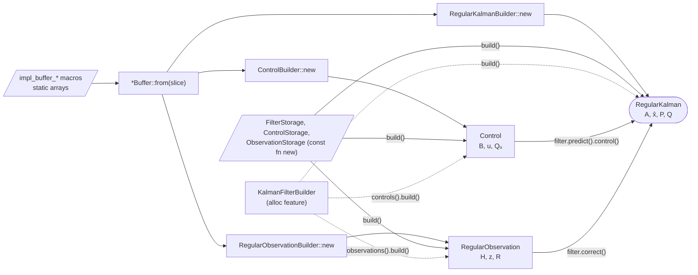
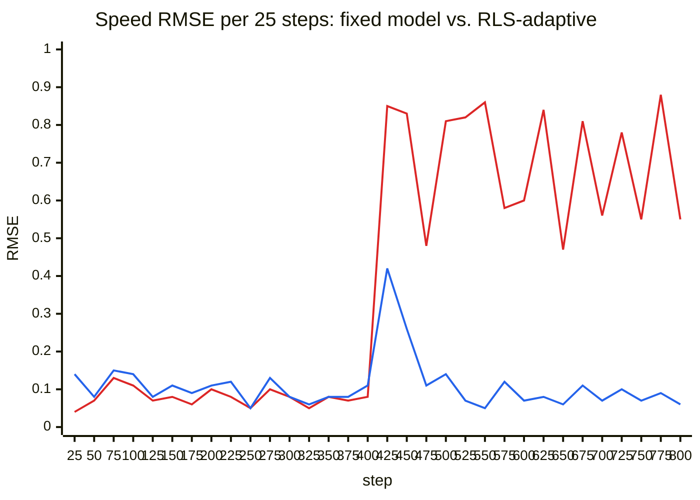
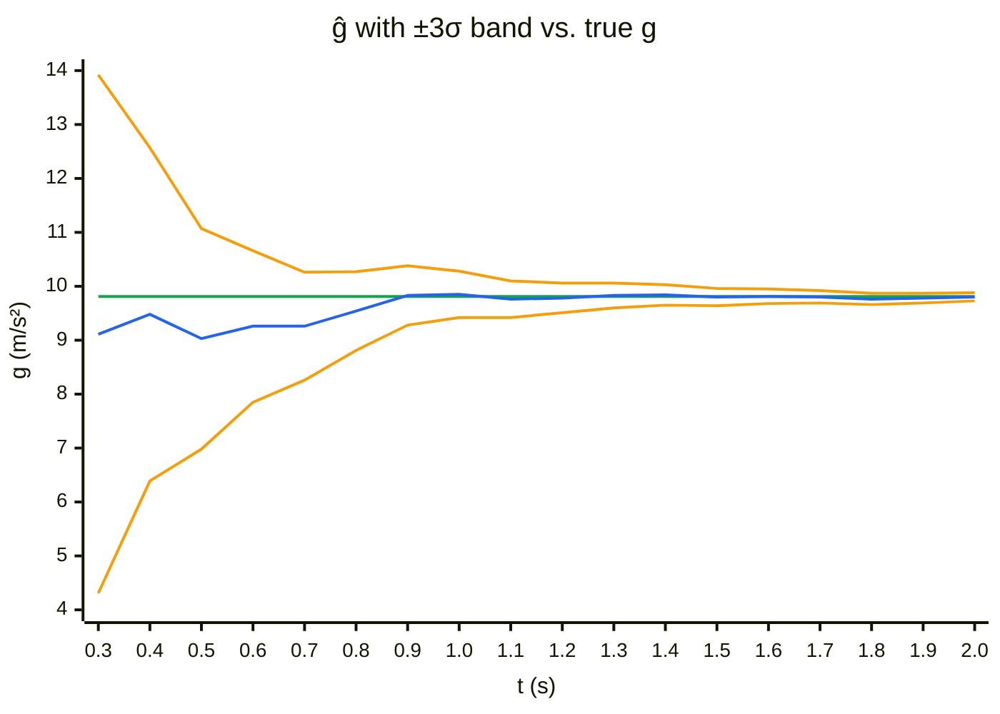

# Kalman Filters for Embedded Targets (in Rust)

[](https://crates.io/crates/minikalman)
[](https://crates.io/crates/minikalman)

[](https://docs.rs/minikalman/)
[](https://codecov.io/gh/sunsided/minikalman-rs)

This is the Rust port of my [kalman-clib](https://github.com/sunsided/kalman-clib/) library, a microcontroller targeted
Kalman filter implementation, as well as the
[libfixkalman](https://github.com/sunsided/libfixkalman) C library for Q16.16 fixed-point Kalman filters. It optionally
uses [`micromath`](https://docs.rs/micromath)
for square root calculations on `no_std`, and can use [`libm`](https://docs.rs/libm) if wished for.
Depending on the configuration, this crate may require `f32` / FPU support.

This implementation uses statically allocated buffers for all matrix operations. Due to lack
of `const` generics for array allocations in Rust, this crate also provides helper macros
to create the required arrays.

Try it in the browser: the [live demo](https://sunsided.github.io/minikalman-rs/) runs the Extended and
Unscented Kalman filters, compiled to WebAssembly, side by side on a radar tracking problem.

<div align="center">
    
</div>

## Which filter do I need?

Pick the filter from the model, then add what the measurements need: an innovation gate, the
Student-t robust correction or the predictively oriented correction against outliers, noise
adaptation when `R` is unknown, and a smoother when the estimate may lag behind the
measurements. When model parameters themselves are unknown or drift, recursive least squares
identifies them online and feeds them into the filter's model.



## `no_std` vs `std`, `alloc`

This crate builds as `no_std` by default. To build with `std` support, run:

```shell
cargo build --features=std
```

Independently of `std` you can turn on `alloc` features. This enables simplified builders with heap-allocated buffers:

```shell
cargo build --features=alloc
```

## Examples

The first example sets up a filter [without allocation](#without-allocation-no_std), for `no_std`
targets. The others use the `alloc` builders and follow the order of
[Which filter do I need?](#which-filter-do-i-need):

- [Regular filter](#targets-with-allocations-std-or-alloc) for linear models
- [Information filter](#information-filter-fusing-sensors) for fusing many independent sensors
- [UD filter](#ud-filter) for fixed-point or ill-conditioned problems
- [Fixed-gain (Luenberger) observer](#fixed-gain-luenberger-observer) for a steady-state gain
  without a covariance, designed from `Q` and `R`
- [Extended Kalman filter](#extended-kalman-filters) for nonlinear models with Jacobians
- [Unscented Kalman filter](#unscented-kalman-filter) for nonlinear models without Jacobians
- [Robust corrections](#robust-corrections-gating-and-noise-adaptation): NIS gate, predictively
  oriented correction, noise adaptation, covariance update form
- [Angle wrapping](#angle-wrapping) for headings and bearings
- [Smoothing](#smoothing-a-recorded-run) a recorded run
- [Embedded targets](#embedded-targets), [fixed-point](#q1616-fixed-point) and the
  [gravity](#gravity-constant-estimation-example) example

Each step of the regular filter predicts, applies the optional control, and corrects with
each measurement.



Filters, controls and observations own their matrices as buffers. On embedded targets, the
storage types or the `impl_buffer_*` macros hold them in static or stack arrays; with `alloc`,
the builders allocate them:



### Without allocation (`no_std`)

This example works without `std` and without `alloc`. The `impl_buffer_*!` macros create
each matrix as a fixed-size local array (`mut name`), or as a `static` with `static mut name`
(borrowed through `&raw mut`, since edition 2024 denies plain references to a `static mut`),
and the filter and observation builders take ownership of them.

It is verbose on purpose: every buffer the filter will ever use is declared up front, with its
size and its placement (stack or static memory), so the memory a filter needs is visible in the
source and fixed at compile time. Nothing is allocated behind your back, and no buffer grows at
runtime.

```rust
use minikalman::prelude::*;
use minikalman::regular::{RegularKalmanBuilder, RegularObservationBuilder};

const NUM_STATES: usize = 2; // position, velocity
const NUM_OBSERVATIONS: usize = 1; // position

// Filter buffers: A, x̂, P, Q and two temporaries, as local arrays.
impl_buffer_A!(mut a, NUM_STATES, f32, 0.0);
impl_buffer_x!(mut x, NUM_STATES, f32, 0.0);
impl_buffer_P!(mut p, NUM_STATES, f32, 0.0);
impl_buffer_Q_direct!(mut q, NUM_STATES, f32, 0.0);
impl_buffer_temp_x!(mut temp_x, NUM_STATES, f32, 0.0);
impl_buffer_temp_P!(mut temp_p, NUM_STATES, f32, 0.0);

// Observation buffers: H, z, R, the innovation y, its covariance S, the gain K and temporaries.
impl_buffer_H!(mut h, NUM_OBSERVATIONS, NUM_STATES, f32, 0.0);
impl_buffer_z!(mut z, NUM_OBSERVATIONS, f32, 0.0);
impl_buffer_R!(mut r, NUM_OBSERVATIONS, f32, 0.0);
impl_buffer_y!(mut y, NUM_OBSERVATIONS, f32, 0.0);
impl_buffer_S!(mut s, NUM_OBSERVATIONS, f32, 0.0);
impl_buffer_K!(mut k, NUM_STATES, NUM_OBSERVATIONS, f32, 0.0);
impl_buffer_temp_S_inv!(mut temp_s_inv, NUM_OBSERVATIONS, f32, 0.0);
impl_buffer_temp_HP!(mut temp_hp, NUM_OBSERVATIONS, NUM_STATES, f32, 0.0);
impl_buffer_temp_PHt!(mut temp_pht, NUM_STATES, NUM_OBSERVATIONS, f32, 0.0);
impl_buffer_temp_KHP!(mut temp_khp, NUM_STATES, f32, 0.0);

let mut filter = RegularKalmanBuilder::new::<NUM_STATES, f32>(a, x, p, q, temp_x, temp_p);
let mut measurement = RegularObservationBuilder::new::<NUM_STATES, NUM_OBSERVATIONS, f32>(
    h, z, r, y, s, k, temp_s_inv, temp_hp, temp_pht, temp_khp,
);

// Constant velocity with a time step of 0.1 s, and noise on the velocity only.
filter.state_transition_mut().apply(|a| {
    a.set(0, 0, 1.0);
    a.set(0, 1, 0.1);
    a.set(1, 1, 1.0);
});
filter.direct_process_noise_mut().set(1, 1, 0.01);
filter.estimate_covariance_mut().make_scalar(10.0);
measurement.observation_matrix_mut().set(0, 0, 1.0);
measurement.measurement_noise_covariance_mut().set(0, 0, 0.01);

for position in [0.1, 0.2, 0.32, 0.4, 0.49, 0.61, 0.7, 0.79] {
    filter.predict();
    measurement.measurement_vector_mut().set(0, 0, position);
    filter.correct(&mut measurement);
}

// The object moves at about 1 m/s.
let velocity = filter.state_vector().get(1, 0);
assert!(velocity > 0.5 && velocity < 1.5);
```

After that, the filter is used the same way as in the examples below. The
[`gravity`](https://github.com/sunsided/minikalman-rs/blob/main/crates/minikalman/tests/gravity.rs)
test uses the same macros and builders; the [`xbuild-tests/stm32`] firmware uses the storage
types below.

### Without allocation, shorter: storage types

The storage types are a shorter route to the same explicit, compile-time-fixed memory. Each
one holds all buffers of a filter part as const-generic arrays, with exactly the size of the
`impl_buffer_*` buffers it replaces: `regular::{FilterStorage, ObservationStorage,
ControlStorage}`, the same pair in `extended`, `unscented::{FilterStorage, ObservationStorage}`
(with a compile-time check of the sigma point count), `information::FilterStorage` and
`smoother::RtsSmootherStorage`. `new` is a `const fn`, and `build()` wires the filter to borrow
the storage. The example above becomes:

```rust
use minikalman::prelude::*;
use minikalman::regular::{FilterStorage, ObservationStorage};

const NUM_STATES: usize = 2; // position, velocity
const NUM_OBSERVATIONS: usize = 1; // position

// All filter buffers (A, x̂, P, Q, temporaries) and all observation buffers in two values.
let mut filter_storage = FilterStorage::<NUM_STATES, f32>::new(0.0);
let mut measurement_storage = ObservationStorage::<NUM_STATES, NUM_OBSERVATIONS, f32>::new(0.0);
let mut filter = filter_storage.build();
let mut measurement = measurement_storage.build();

filter.state_transition_mut().apply(|a| {
    a.set(0, 0, 1.0);
    a.set(0, 1, 0.1);
    a.set(1, 1, 1.0);
});
filter.direct_process_noise_mut().set(1, 1, 0.01);
filter.estimate_covariance_mut().make_scalar(10.0);
measurement.observation_matrix_mut().set(0, 0, 1.0);
measurement.measurement_noise_covariance_mut().set(0, 0, 0.01);

for position in [0.1, 0.2, 0.32, 0.4, 0.49, 0.61, 0.7, 0.79] {
    filter.predict();
    measurement.measurement_vector_mut().set(0, 0, position);
    filter.correct(&mut measurement);
}

let velocity = filter.state_vector().get(1, 0);
assert!(velocity > 0.5 && velocity < 1.5);
```

The storage allocates nothing, and `build()` moves no arrays: the filter only borrows it. On
small targets, put large storage in a `static` (a zero `init` lands in `.bss`) instead of on
the stack, and take the `&'static mut` through a take-once cell such as
`static_cell::ConstStaticCell` rather than a `static mut`. The `impl_buffer_*` macros stay the
tool for custom layouts, such as buffers in different memory sections.

With several observations, their temporaries (49 of the 97 values of a 4-state, 3-measurement
observation) can be shared: a `LeanObservationStorage` holds only `H`, `z`, `R`, `y`, `S` and
`K`, and one `CorrectionScratch` sized for the largest observation lends the temporaries per
call, `filter.correct_in(&mut gps, &mut scratch)` (`correct_nonlinear_in` for the EKF). The
borrow checker keeps the sharing one correction at a time, and the results are bit-identical.


`minikalman::state!` names the entries, so models and Jacobians index by name instead of by
number:

```rust
use minikalman::prelude::*;
use minikalman::extended::FilterStorage;

minikalman::state! { struct Track(f32) { position, velocity } }

let mut filter_storage = FilterStorage::<{ Track::N }, f32>::new(0.0);
let mut filter = filter_storage.build();
filter.state_transition_jacobian_mut().apply(|a| {
    a.make_identity();
    a.set_at(Track::position, Track::velocity, 0.1);
});
filter.predict_nonlinear(|x, next| {
    let s = Track::read(x.as_slice());
    Track { position: s.position + 0.1 * s.velocity, ..s }.write(next.as_mut_slice());
});
```

With the opt-in `derive` feature (Rust 1.88), a `#[repr(C)]` struct derived with `UniformArray`
views the vector in place instead of copying. The derive emits the cast only when your crate
declares *and enables* its own `unsafe` feature:

```toml
[dependencies]
minikalman = { version = "0.8", features = ["derive"] }

[features]
default = ["unsafe"] # or build with `--features unsafe`
unsafe = []
```

```rust,ignore
#[derive(minikalman::UniformArray)]
#[repr(C)]
struct TrackView { position: f32, velocity: f32 }

minikalman::named_vector!(TrackView);

filter.predict_nonlinear(|x, next| {
    let (s, n) = (x.view::<TrackView>(), next.view_mut::<TrackView>());
    n.position = s.position + 0.1 * s.velocity;
    n.velocity = s.velocity;
});
let velocity = filter.state_vector().view::<TrackView>().velocity;
```

A struct whose field count differs from the vector length fails to build. See the
`named_vector` module docs for the setup.

### Declaring filters: `filter!`

`minikalman::filter!` declares the parts of a filter by name and generates their storage and
wiring. Here two filters share one observation and one control:

```rust
use minikalman::prelude::*;

const DT: f32 = 0.1;

minikalman::filter! {
    pub state Track(f32) { pos, vel }

    pub control throttle: Throttle for Track { accel } {
        B[pos, accel] = 0.5 * DT * DT;
        B[vel, accel] = DT;
        Q = diag(0.01);
    }

    pub observation gps: Gps for Track { pos } { H = [pos]; R = diag(0.5); }

    pub kalman fast for Track { A = identity; A[pos, vel] = DT; Q = diag(0.1); P = diag(10.0); }
    pub kalman slow for Track { A = identity; A[pos, vel] = DT; Q = diag(0.001); P = diag(10.0); }

    /// One value holding every buffer, its size checked at compile time.
    pub system tracking { fast, slow, gps, throttle }
}

fn main() {
    let mut storage = tracking::new(); // `const fn`: a `static` works too
    let mut sys = tracking::build(&mut storage); // wires only
    tracking::model(&mut sys); // writes the declared matrices

    for k in 0..50 {
        let t = k as f32 * DT;
        Throttle { accel: 1.0 }.write(sys.throttle.control_vector_mut().as_mut_slice());
        for filter in [&mut sys.fast, &mut sys.slow] {
            filter.predict().control(&mut sys.throttle);
            Gps { pos: 0.5 * t * t }.write(sys.gps.measurement_vector_mut().as_mut_slice());
            filter.correct(&mut sys.gps);
        }
    }

    let velocity = Track::read(sys.fast.state_vector().as_slice()).vel;
    assert!((velocity - 4.9).abs() < 0.5);
}
```

Each item becomes a module (`fast::Storage`, `fast::new`, `fast::build`, `fast::model`) over
the library's own storage types, so memory stays explicit, and you call the usual API on what
`build` returns. `build` only wires, like the storage types' `build()`. `model` writes the
declared values, and calling it again resets them. The `filter!` docs build up from the
smallest filter to lean observations with a shared scratch, a Luenberger observer, `static`
placement and fixed point, and end with the grammar. A block can also choose where its memory
lives: `storage = owned;` gives a movable value without a lifetime for a struct field,
`storage = boxed;` puts each matrix on the heap, and `P = extern;` borrows a buffer you own,
such as a DMA region.
[`examples/filter_dsl.rs`](crates/minikalman/examples/filter_dsl.rs) runs the two filters
above next to an observer with a settled gain.

### Targets with allocations (`std` or `alloc`)

When the `alloc` crate feature is enabled either directly or implicitly via `std`,
some builders are enabled that allow for simple creation of filters. This should help non-embedded use cases, or any
use case that does not have to explicitly manage buffer locations, to get an easier start:

```rust
use minikalman::prelude::*;
use minikalman::regular;

const NUM_STATES: usize = 3;
const NUM_CONTROLS: usize = 2;
const NUM_OBSERVATIONS: usize = 1;

let builder = regular::builder::KalmanFilterBuilder::<NUM_STATES, f32>::default();
let mut filter = builder.build();
let mut control = builder.controls().build::<NUM_CONTROLS>();
let mut measurement = builder.observations().build::<NUM_OBSERVATIONS>();

// Set up the system dynamics, control matrices, observation matrices, ...
filter.state_transition_mut().make_identity();
filter.estimate_covariance_mut().make_scalar(100.0);
control.control_matrix_mut().apply(|b| {
    b.set(1, 0, 1.0); // u[0] drives the second state
    b.set(2, 1, 1.0); // u[1] drives the third state
});
control.process_noise_covariance_mut().make_scalar(0.01);
measurement.observation_matrix_mut().set(0, 0, 1.0); // we measure the first state
measurement.measurement_noise_covariance_mut().set(0, 0, 1.0);

// Filter!
for _ in 0..50 {
    // Update your control vector(s).
    control.control_vector_mut().apply(|u| {
        u[0] = 0.0;
        u[1] = 1.0;
    });

    // Update your measurement vectors.
    measurement.measurement_vector_mut().apply(|z| {
        z[0] = 42.0;
    });

    // Predict, then apply each control input to the prediction.
    filter.predict().control(&mut control);

    // Apply any measurements.
    filter.correct(&mut measurement);
}

// Access the state and its covariance.
let state = filter.state_vector();
let covariance = filter.estimate_covariance();
assert!((state.get(0, 0) - 42.0).abs() < 1.0);
assert!((state.get(2, 0) - 50.0).abs() < 1.0); // u[1] = 1 added in each of the 50 steps
assert!(covariance.get(0, 0) < 1.0);
```

### Information filter: fusing sensors

The information filter keeps `Y = P⁻¹` and `ŷ = P⁻¹·x̂` instead of `x̂` and `P`. Each sensor
then adds its information, `Y ← Y + Hᵀ·R⁻¹·H`, in any order and without inverting `Y`. Use it
when many independent sensors report at once, or when the start is truly unknown (`Y = 0`):

```rust
use minikalman::prelude::*;
use minikalman::regular::builder::KalmanFilterBuilder;

// Position and velocity; the filter starts with no information at all (Y = 0).
let builder = KalmanFilterBuilder::<2, f32>::default();
let mut filter = builder.build_information();
filter.state_transition_mut().apply(|a| {
    a.set(0, 0, 1.0);
    a.set(0, 1, 0.1);
    a.set(1, 1, 1.0);
});
filter.process_noise_mut().set(1, 1, 0.01);

let mut gps = builder.observations().build::<1>();
gps.observation_matrix_mut().set(0, 0, 1.0);
gps.measurement_noise_covariance_mut().set(0, 0, 4.0);

let mut wheel_speed = builder.observations().build::<1>();
wheel_speed.observation_matrix_mut().set(0, 1, 1.0);
wheel_speed.measurement_noise_covariance_mut().set(0, 0, 0.25);

for (position, speed) in [(0.1, 1.0), (0.2, 1.1), (0.35, 0.9), (0.4, 1.0)] {
    gps.measurement_vector_mut().set(0, 0, position);
    wheel_speed.measurement_vector_mut().set(0, 0, speed);
    assert!(filter.fuse(&mut gps));
    assert!(filter.fuse(&mut wheel_speed));
    assert!(filter.predict());
}

// Recover x̂ = Y⁻¹·ŷ and P = Y⁻¹ when needed; this costs one inversion.
let mut x = BufferBuilder::state_vector_x::<2>().new();
let mut p = BufferBuilder::estimate_covariance_P::<2>().new();
assert!(filter.state(&mut x, &mut p));
assert!(x.get(1, 0) > 0.5 && p.get(0, 0) < 4.0);
```

`predict` and `state` invert `Y`, so they return `false` while some state is still unobserved.
The [`information_filter`](https://github.com/sunsided/minikalman-rs/blob/main/crates/minikalman/tests/information_filter.rs)
test compares it step by step to the regular filter.

### UD filter

`ud::UdKalman` is a linear filter that keeps `P` factored as `U·D·Uᵀ`, which stays positive
semi-definite whatever rounding does, and never takes a square root. Use it on fixed-point
targets (e.g. `I16F16`) or for ill-conditioned problems where the plain filter's `P` turns
indefinite:

```rust
use minikalman::prelude::*;
use minikalman::regular::builder::KalmanFilterBuilder;

// The prediction workspace is 2 × STATES wide.
let builder = KalmanFilterBuilder::<2, f32>::default();
let mut filter = builder.build_ud::<4>();
let mut gps = builder.observations().build::<1>();
filter.state_transition_mut().apply(|a| {
    a.set(0, 0, 1.0);
    a.set(0, 1, 0.1);
    a.set(1, 1, 1.0);
});

// Q and the initial P are given in full and factored once.
let mut q = BufferBuilder::direct_process_noise_covariance_Q::<2>().new();
q.set(1, 1, 0.01);
assert!(filter.set_process_noise(&q));
let mut x = BufferBuilder::state_vector_x::<2>().new();
let mut p = BufferBuilder::estimate_covariance_P::<2>().new();
p.make_identity();
assert!(filter.set_state(&x, &p));

gps.observation_matrix_mut().set(0, 0, 1.0);
gps.measurement_noise_covariance_mut().set(0, 0, 4.0);
for z in [0.1, 0.25, 0.3, 0.45] {
    filter.predict();
    gps.measurement_vector_mut().set(0, 0, z);
    assert!(filter.correct(&mut gps).is_applied());
}

// Multiply the factors back out into x̂ and P.
filter.state(&mut x, &mut p);
assert!(p.get(0, 0) > 0.0 && p.get(0, 0) < 1.0);
```

The [`ud`](https://docs.rs/minikalman/latest/minikalman/ud/index.html) module docs give the
value ranges that fit `I16F16`.

### Fixed-gain (Luenberger) observer

A Kalman filter tunes *trust*: `Q` and `R` say how far the model and the sensor are trusted,
and the filter recomputes the optimal gain every step, carrying `P` to do so. A Luenberger
observer tunes *dynamics*: the gain is fixed and sets how fast the estimation error dies out.
On a time-invariant model the two meet, since the Kalman gain converges to a constant `K∞`.
`RegularKalman::settle_gain` iterates the filter's own covariance recursion to that gain
(it overwrites the filter's `P` and the observation's `S` and `K`, so run it at design or boot
time), and `regular::LuenbergerObserver` then runs it with no `P`, `Q` or `R`: `n² + 2·n·m`
multiply-adds per step, no square root, no division, the same work every step.

```rust
use minikalman::models::motion;
use minikalman::prelude::*;
use minikalman::regular::builder::KalmanFilterBuilder;

let builder = KalmanFilterBuilder::<2, f32>::default();
let model = motion::constant_velocity(0.1, 1.0);

// Design once with Q and R.
let mut design = builder.build();
let mut gps = builder.observations().build::<1>();
design.state_transition_mut().apply(|a| model.fill_transition(a));
design.direct_process_noise_mut().apply(|q| model.fill_process_noise(q));
design.estimate_covariance_mut().make_identity();
gps.observation_matrix_mut().set(0, 0, 1.0);
gps.measurement_noise_covariance_mut().set(0, 0, 0.25);
design.settle_gain(&mut gps, 1e-6, 10_000).expect("detectable model");

// Run with the fixed gain K∞ ≈ [0.1812, 0.1810].
let mut observer = builder.build_observer();
let mut gps_fixed = builder.observations().build_fixed_gain::<1, Current>();
observer.state_transition_mut().apply(|a| model.fill_transition(a));
gps_fixed.observation_matrix_mut().set(0, 0, 1.0);
gps_fixed.set_gain(gps.kalman_gain());

for z in [0.1, 0.25, 0.3, 0.45] {
    observer.predict();
    gps_fixed.measurement_vector_mut().set(0, 0, z);
    assert!(observer.correct(&mut gps_fixed).is_applied());
}
```

Mind the gain convention. The crate's order (`predict`, then `correct`) is the *current* form
`x̂⁺ = x̂⁻ + K·(z − H·x̂⁻)`, and `settle_gain` returns that `K`. `place`, `acker` and
python-control `dlqe` return the *predictor*-form gain `L = A·K` of
`x̂ₖ₊₁ = A·x̂ₖ + L·(zₖ − H·x̂ₖ)`. The form is a type parameter, so pairing a gain with the
observer of the other form does not compile; that matters, because a deadbeat `L = [2, 10]` run
as a current-form gain diverges. Store `L` in a `build_fixed_gain::<M, Predictor>()` observation
and run it on `build_predictor_observer()`. Its steps keep the same split as the current form:
`correct` forms `y = z − H·x̂` and defers `L·y` without touching `x̂`, and the next `predict`
applies `x̂ ← A·x̂ + L·y`. In both forms, `predict()` returns a handle for the control inputs of
the step, e.g. `observer.predict().control(&mut throttle).control(&mut steering)`, so controls
cannot slip in after a correction. For fixed point, compute the gain in `f32` or `f64` and convert it: an `I16F16`
observer then stays within about `LSB / (1 − ρ)` of the float one (6 LSB in the
[`luenberger`](https://github.com/sunsided/minikalman-rs/blob/main/crates/minikalman/tests/luenberger.rs) test), with the closed-loop spectral
radius `ρ`. The `ObserverStorage`, `PredictorObserverStorage` and `FixedGainObservationStorage`
types hold the buffers
without allocation; see the [`luenberger` example](https://github.com/sunsided/minikalman-rs/blob/main/crates/minikalman/examples/luenberger.rs).

To reject outliers without `P`, build the observation with `build_fixed_gain_gated` (or
`GatedFixedGainObservationStorage`), store the settled `S∞⁻¹` with
`set_innovation_covariance` and set a threshold with `set_gate`: corrections whose
`NIS = yᵀ·S∞⁻¹·y` exceeds it return `CorrectionStatus::Gated` and leave `x̂` unchanged, for
`m² + m` more multiply-adds. In steady state this is the Kalman filter's gate. During start-up
the true innovations are larger than `S∞`, and a fixed `S∞` never widens after rejections, so
keep the gate off until the observer has settled.

### Recursive least squares: identifying model parameters online

`rls::RecursiveLeastSquares` estimates parameters `θ` of a model whose output is linear in
them, `y = φᵀ·θ + v`, one sample at a time in `O(N²)`, without allocation or matrix
inversion. It is the Kalman filter with `A = I`, `Q = 0` and `H = φᵀ`, and its forgetting factor
`μ` is the fading memory of
[`predict_tuned(λ)`](https://docs.rs/minikalman/latest/minikalman/regular/struct.RegularKalman.html#method.predict_tuned)
with `μ = λ²` (while the windup guard is inactive). By default it keeps `P = U·D·Uᵀ`
(Bierman's update, positive semi-definite in `f32` and `I16F16`) and bounds `tr(P)` against
covariance windup when the input stops exciting the system:

```rust
use minikalman::prelude::*;
use minikalman::rls::EstimatorStorage;

// First-order plant xₖ₊₁ = a·xₖ + b·uₖ: θ = [a, b], φ = [xₖ, uₖ], y = xₖ₊₁.
let mut storage = EstimatorStorage::<2, f32>::new(0.0);
let mut rls = storage.build(100.0);
rls.set_forgetting_factor(0.98);

let (a, b) = (0.9, 0.5);
let mut x = 0.0;
for k in 0..200 {
    let u = if (k / 10) % 2 == 0 { 1.0 } else { -1.0 };
    let next = a * x + b * u;
    assert!(rls.update(&[x, u], next).is_applied());
    x = next;
}

assert!((rls.parameters().get_row(0) - a).abs() < 1e-3);
assert!((rls.parameters().get_row(1) - b).abs() < 1e-3);
```

The [`rls-adaptive`] example uses this for dual estimation. A motor's speed follows
`xₖ₊₁ = a·xₖ + b·uₖ + w`, measured with σ = 0.2. At step 400 the load changes, and the true
`(a, b)` jump from `(0.9, 0.5)` to `(0.7, 1.0)`. A Kalman filter with the fixed nominal model
runs next to one whose `A` and `B` come from the RLS estimate each step:

```shell
cargo run --example rls-adaptive --features=std
```

```text
  speed RMSE            fixed   adaptive   (sensor σ = 0.2)
  before the change     0.084   0.105
  first 50 steps after  0.840   0.351
  settled after         0.701   0.090
```

Before the change, the fixed filter has the exact model; the adaptive one pays a little for
learning it from noisy data. After the change, the fixed model is wrong and its error grows
about eightfold, while the adaptive filter re-identifies the plant within a few dozen steps.
Rolling RMSE per 25 steps, fixed model (red) and RLS-adaptive (blue):



The noise is seeded; regenerate the chart with `-- --chart`.

[`rls-adaptive`]: https://github.com/sunsided/minikalman-rs/tree/main/crates/minikalman/examples/rls_adaptive.rs

### Extended Kalman Filters

The general setup remains the same, however the `predict` and `correct` methods are
replaced with their nonlinear counterparts:

```rust
use minikalman::prelude::*;
use minikalman::extended;
use rand::rngs::StdRng;
use rand::SeedableRng;
use rand_distr::{Distribution, Normal};

const NUM_STATES: usize = 4; // position x, y; velocity x, y
const NUM_OBSERVATIONS: usize = 1; // distance from the origin

let builder = extended::builder::KalmanFilterBuilder::<NUM_STATES, f32>::default();
let mut filter = builder.build();
let mut measurement = builder.observations().build::<NUM_OBSERVATIONS>();

// The time step of our simulation.
const DELTA_T: f32 = 0.1;

// Set up the initial state vector: a rough guess of where the object is and how it moves.
filter.state_vector_mut().apply(|vec| {
    vec.set_row(0, 1.0);
    vec.set_row(1, 1.0);
    vec.set_row(2, 0.5);
    vec.set_row(3, 0.5);
});

// Set up the initial estimate covariance as an identity matrix.
filter.estimate_covariance_mut().make_identity();

// Set up the process noise covariance matrix.
filter.direct_process_noise_mut().make_scalar(1e-4);

// Set up the measurement noise covariance.
measurement.measurement_noise_covariance_mut().apply(|mat| {
    mat.set_value(0.25); // matrix is 1x1
});

// The object starts at (1, 1) m and moves at (1, 1) m/s; the sensor noise is seeded.
let mut rng = StdRng::seed_from_u64(42);
let measurement_noise = Normal::new(0.0, 0.5).unwrap();
let true_distance = |time: f32| 2.0f32.sqrt() * (1.0 + time);

// Simulate
for step in 1..=100 {
    let time = step as f32 * DELTA_T;

    // Update the system transition Jacobian matrix.
    filter.state_transition_jacobian_mut().apply(|mat| {
        mat.make_identity();
        mat.set(0, 2, DELTA_T);
        mat.set(1, 3, DELTA_T);
    });

    // Perform a nonlinear prediction step.
    filter.predict_nonlinear(|state, next| {
        // Simple constant velocity model.
        next[0] = state[0] + state[2] * DELTA_T;
        next[1] = state[1] + state[3] * DELTA_T;
        next[2] = state[2];
        next[3] = state[3];
    });

    // Perform a noisy measurement of the (simulated) distance.
    let z = true_distance(time) + measurement_noise.sample(&mut rng);
    measurement.measurement_vector_mut().apply(|vec| vec.set_value(z));

    // Update the observation Jacobian.
    measurement.observation_jacobian_matrix_mut().apply(|mat| {
        let x = filter.state_vector().get_row(0);
        let y = filter.state_vector().get_row(1);

        let norm = (x.powi(2) + y.powi(2)).sqrt();
        mat.set_col(0, x / norm);
        mat.set_col(1, y / norm);
        mat.set_col(2, 0.0);
        mat.set_col(3, 0.0);
    });

    // Apply nonlinear correction step.
    filter.correct_nonlinear(&mut measurement, |state, observation| {
        // Transform the state into an observation.
        let x = state.get_row(0);
        let y = state.get_row(1);
        let z = (x.powi(2) + y.powi(2)).sqrt();
        observation.set_value(z);
    });
}

// The estimated distance follows the true one.
let (x, y) = (filter.state_vector().get_row(0), filter.state_vector().get_row(1));
assert!(((x.powi(2) + y.powi(2)).sqrt() - true_distance(10.0)).abs() < 1.0);
```

For a slightly more realistic EKF example that simulates radar measurements of a moving object,
see the [`radar-2d`](https://github.com/sunsided/minikalman-rs/blob/main/crates/minikalman/examples/radar_2d.rs) example.

```shell
cargo run --example radar-2d --features=std
```

### Unscented Kalman Filter

The unscented filter propagates `2n + 1` sigma points through the nonlinear `f` and `h`
themselves, so it needs no Jacobians and copes with stronger nonlinearity than the EKF. Here,
a pendulum's angle and angular rate are tracked from the bob's horizontal position:

```rust
use minikalman::prelude::*;
use minikalman::unscented::builder::KalmanFilterBuilder;

const NUM_STATES: usize = 2; // angle θ (rad), angular rate ω (rad/s)
const NUM_SIGMA: usize = 2 * NUM_STATES + 1;
const DT: f32 = 0.05;
const G_OVER_L: f32 = 9.81; // a pendulum of length 1 m

let builder = KalmanFilterBuilder::<NUM_STATES, f32>::default();
let mut filter = builder.build::<NUM_SIGMA>();
let mut bob = builder.observations().build::<1, NUM_SIGMA>();

// Cubature Kalman filter weights: all positive, no centre point.
filter.set_alpha(1.0);
filter.set_beta(0.0);
filter.set_kappa(0.0);

filter.state_vector_mut().set_at(0, 0, 0.2);
filter.estimate_covariance_mut().make_scalar(0.1);
filter.direct_process_noise_mut().make_scalar(1e-4);
bob.measurement_noise_covariance_mut().make_scalar(1e-3);

for step in 1..=100 {
    // f is applied to every sigma point.
    filter.predict_nonlinear(|x| {
        let (theta, omega) = (x.as_matrix().get_at(0, 0), x.as_matrix().get_at(1, 0));
        x.as_matrix_mut().set_at(0, 0, theta + omega * DT);
        x.as_matrix_mut().set_at(1, 0, omega - G_OVER_L * theta.sin() * DT);
    });

    let truth = 0.3 * (G_OVER_L.sqrt() * step as f32 * DT).cos();
    bob.measurement_vector_mut().set_at(0, 0, truth.sin());

    // h maps each predicted sigma point (column j of a STATES × NUM_SIGMA matrix).
    filter.correct_sigma_point(&mut bob, |sigma, observed| {
        for j in 0..NUM_SIGMA {
            observed[j] = sigma[j].sin();
        }
    });
}

let truth = 0.3 * (G_OVER_L.sqrt() * 100.0 * DT).cos();
assert!((filter.state_vector().get_at(0, 0) - truth).abs() < 0.05);
```

The builder defaults to `α = 1`, `β = 2`, `κ = 1`; the cubature settings above are often the
better choice under strong nonlinearity. See the
[`UnscentedKalman`](https://docs.rs/minikalman/latest/minikalman/unscented/struct.UnscentedKalman.html)
docs for how the parameters place and weight the sigma points, and the
[`radar-2d-ukf`](https://github.com/sunsided/minikalman-rs/blob/main/crates/minikalman/examples/radar_2d_ukf.rs)
and [`radar_2d_ukf_builder`](https://github.com/sunsided/minikalman-rs/blob/main/crates/minikalman/examples/radar_2d_ukf_builder.rs)
examples for a range-bearing tracker.

### Robust corrections: gating and noise adaptation

Each observation can reject outliers and learn its own noise. Use the gate when readings are
occasionally wrong, the predictively oriented correction when the noise is heavy-tailed, and
noise adaptation when `R` is not known in advance:

```rust
use minikalman::prelude::*;
use minikalman::regular::builder::KalmanFilterBuilder;
use minikalman::regular::CovarianceUpdate;

let builder = KalmanFilterBuilder::<1, f32>::default();
let mut filter = builder.build();
let mut sensor = builder.observations().build::<1>();
filter.state_transition_mut().make_identity();
filter.direct_process_noise_mut().make_scalar(0.01);
filter.estimate_covariance_mut().make_scalar(1.0);
sensor.observation_matrix_mut().make_identity();
sensor.measurement_noise_covariance_mut().make_scalar(1.0);

// Skip readings whose NIS = yᵀ·S⁻¹·y exceeds the 99% χ² quantile for one measurement.
sensor.set_gate(Some(6.63));
// Learn R from the residuals, forgetting old ones with α = 0.95.
sensor.set_noise_adaptation(Some(NoiseAdaptation { forgetting: 0.95, floor: 0.01 }));

for z in [0.2, -0.1, 0.1, 50.0, 0.0] {
    filter.predict();
    sensor.measurement_vector_mut().set_at(0, 0, z);
    let status = filter.correct(&mut sensor);
    assert_eq!(status == CorrectionStatus::Gated, z == 50.0);
}

// Instead of a hard gate, the predictively oriented correction down-weights large
// innovations; it takes a budget of Newton steps and scalar observations.
sensor.set_gate(None);
sensor.measurement_vector_mut().set_at(0, 0, 8.0);
assert!(filter.correct_predictively_oriented(&mut sensor, 20).is_applied());

// The Joseph form keeps P symmetric and is the default. Opt into the cheaper
// P ← P − K·H·P only where its extra products do not fit the budget.
sensor.set_covariance_update(CovarianceUpdate::Standard);
```

The same `set_gate` and `set_noise_adaptation` exist on extended and unscented observations;
the extended filter has `correct_nonlinear_predictively_oriented`, and all three have a
Student-t robust correction (`correct_robust` and its nonlinear variants). The
[`numerical_robustness`](https://github.com/sunsided/minikalman-rs/blob/main/crates/minikalman/tests/numerical_robustness.rs)
test bench measures what the Joseph form buys.

### Angle wrapping

A heading of `3.1` rad and a reading of `−3.1` rad are `0.08` rad apart, not `6.2`. Wrap the
innovation with `correct_with`, and keep the state itself wrapped, whenever a state or
measurement is an angle:

```rust
use minikalman::angles::wrap_pi;
use minikalman::prelude::*;
use minikalman::regular::builder::KalmanFilterBuilder;

let builder = KalmanFilterBuilder::<1, f32>::default();
let mut filter = builder.build();
let mut compass = builder.observations().build::<1>();
filter.state_transition_mut().make_identity();
filter.estimate_covariance_mut().make_identity();
compass.observation_matrix_mut().make_identity();
compass.measurement_noise_covariance_mut().make_identity();

// The heading is just below +π; the compass reads just above −π.
filter.state_vector_mut().set_at(0, 0, 3.1);
compass.measurement_vector_mut().set_at(0, 0, -3.1);

filter.predict();
filter.correct_with(&mut compass, |y| y[0] = wrap_pi(y[0]));
filter.state_vector_mut().apply(|x| x.set(0, 0, wrap_pi(x.get(0, 0))));

// The estimate moves across ±π, not 3.1 rad the long way round.
assert!(filter.state_vector().get_at(0, 0).abs() > 3.1);
```

`angles::wrap_180` does the same in degrees; both work with fixed-point types. The
[`compass`](https://github.com/sunsided/minikalman-rs/blob/main/crates/minikalman/examples/compass.rs)
example runs a wrapped and an unwrapped filter side by side:

```shell
cargo run --example compass --features=std
```

### Smoothing a recorded run

The RTS smoother refines every filtered estimate of a recorded run with the measurements
that came after it. Record the predicted values after `predict()` and the filtered ones after
`correct()`, then smooth in place:

```rust
use minikalman::matrix::MatrixDataArray;
use minikalman::models::motion;
use minikalman::prelude::*;
use minikalman::regular::builder::KalmanFilterBuilder;
use minikalman::smoother::RtsSmoother;

type Vector = MatrixDataArray<2, 1, 2, f32>;
type Square = MatrixDataArray<2, 2, 4, f32>;

let builder = KalmanFilterBuilder::<2, f32>::default();
let mut filter = builder.build();
let mut measurement = builder.observations().build::<1>();
let model = motion::constant_velocity(1.0, 0.1);
filter.state_transition_mut().apply(|a| model.fill_transition(a));
filter.direct_process_noise_mut().apply(|q| model.fill_process_noise(q));
filter.estimate_covariance_mut().make_scalar(10.0);
measurement.observation_matrix_mut().set(0, 0, 1.0);
measurement.measurement_noise_covariance_mut().set(0, 0, 1.0);

let readings = [0.1, 1.2, 1.9, 3.1, 3.8, 5.3];
let mut x = vec![Vector::new([0.0; 2]); readings.len()];
let mut p = vec![Square::new([0.0; 4]); readings.len()];
let (mut x_predicted, mut p_predicted) = (x.clone(), p.clone());

for (k, z) in readings.into_iter().enumerate() {
    filter.predict();
    filter.state_vector().inspect(|v| v.copy_to(&mut x_predicted[k]));
    filter.estimate_covariance().inspect(|m| m.copy_to(&mut p_predicted[k]));
    measurement.measurement_vector_mut().set(0, 0, z);
    filter.correct(&mut measurement);
    filter.state_vector().inspect(|v| v.copy_to(&mut x[k]));
    filter.estimate_covariance().inspect(|m| m.copy_to(&mut p[k]));
}

let mut smoother = RtsSmoother::new(
    Square::new([0.0; 4]),
    Square::new([0.0; 4]),
    Square::new([0.0; 4]),
    Vector::new([0.0; 2]),
);
let smoothed = filter
    .state_transition()
    .inspect(|a| smoother.smooth(a, &mut x, &mut p, &x_predicted, &p_predicted));
assert!(smoothed);
```

For online use, `smoother::FixedLagSmoother` runs the same pass over a ring buffer of the last
`N` steps and yields each step smoothed with the `N − 1` steps after it. The
[`smoother`](https://docs.rs/minikalman/latest/minikalman/smoother/index.html) module docs
show both.

### Embedded Targets

An example for STM32F303 microcontrollers can be found in the
[`xbuild-tests/stm32`] directory. It showcases both fixed-point and floating-point support, with
the filter's storage in a `static` that a `static_cell::ConstStaticCell` hands out once.

### `Q16.16` fixed-point

Run the `fixed` example with the `fixed` crate feature. This enables `I16F16` type support, similar to
the [libfixkalman](https://github.com/sunsided/libfixkalman) C library.

```shell
cargo run --example fixed --features=fixed
```

### Gravity Constant Estimation Example

The [`gravity`] example drops an object from 25 m and measures its height at 30 Hz with a
noise of σ = 3 cm. The filter tracks height, velocity and `g` as a state, starting from a poor
guess of `g = 5 ± 5 m/s²`, and fails if the true `g` (9.807 m/s²) ever leaves its 3σ band:

```shell
cargo run --example gravity --features=std
```

```text
  t (s)  height (m)  g (m/s²)  ± 1σ    |ĝ − g|
   0.20      24.847     6.750  ± 2.618  1.17σ
   0.40      24.202     9.482  ± 1.030  0.32σ
   0.60      23.235     9.256  ± 0.468  1.18σ
   0.80      21.868     9.539  ± 0.244  1.10σ
   1.00      20.093     9.851  ± 0.143  0.31σ
   1.20      17.942     9.781  ± 0.092  0.29σ
   1.40      15.334     9.843  ± 0.063  0.57σ
   1.60      12.456     9.812  ± 0.045  0.11σ
   1.80       9.209     9.764  ± 0.034  1.26σ
   2.00       5.352     9.804  ± 0.026  0.10σ

Result: g = 9.804 ± 0.026 m/s² (1σ), true 9.807 m/s², from 60 measurements over 2.0 s
```

After one second, the estimate is within 0.05 m/s² of the true value. Its uncertainty keeps
shrinking, and the true `g` (green) stays inside the ±3σ band (amber) around the estimate
(blue):



The measurements are seeded, so the output is the same on every run. To regenerate the chart,
run `cargo run --example gravity --features=std -- --chart`.

[`gravity`]: https://github.com/sunsided/minikalman-rs/tree/main/crates/minikalman/examples/gravity.rs

[`xbuild-tests/stm32`]: https://github.com/sunsided/minikalman-rs/tree/main/xbuild-tests/stm32

## Testing & Fuzzing

### Property-based tests (stable)

```shell
# Run all tests (default features)
cargo test -p minikalman

# Run property-based tests (requires std)
cargo test -p minikalman --features std --test proptest_matrix
cargo test -p minikalman --features std --test proptest_filter

# Run with no_std-compatible features only
cargo test -p minikalman --no-default-features --features libm,alloc
```

### Conformance suite

The conformance suite checks that the filters compute what the math says. It compares them
against reference vectors from an independent NumPy/SciPy implementation, against analytic
identities (for example, the EKF equals the KF on a linear model, and the RTS smoother equals
the batch least-squares solution), and against chi-square bounds on NEES and NIS over Monte
Carlo runs. It also checks invariants and regression baselines, with stated tolerances for
`f64`, `f32`, `I32F32` and `I16F16`. Run it to convince yourself the crate works, and see
[`tests/conformance/README.md`] for what each check proves and how to regenerate the
references.

```shell
cargo test -p minikalman --test conformance --features std,fixed
cargo test -p minikalman --test conformance --no-default-features --features libm,alloc
cargo test -p minikalman --test conformance --no-default-features --features micromath,alloc
# or all three:
task conformance
```

[`tests/conformance/README.md`]: https://github.com/sunsided/minikalman-rs/tree/main/crates/minikalman/tests/conformance/README.md

### Fuzzing (nightly)

Fuzz targets require a nightly toolchain and `cargo-fuzz`. They live under
`crates/minikalman/fuzz/` and are excluded from the workspace.

```shell
# Install cargo-fuzz (once)
cargo +nightly install cargo-fuzz

# Run individual fuzz targets
cd crates/minikalman/fuzz
cargo +nightly fuzz run matrix_cholesky
cargo +nightly fuzz run matrix_mult
cargo +nightly fuzz run regular_filter
cargo +nightly fuzz run extended_filter -- -max_total_time=60
```
