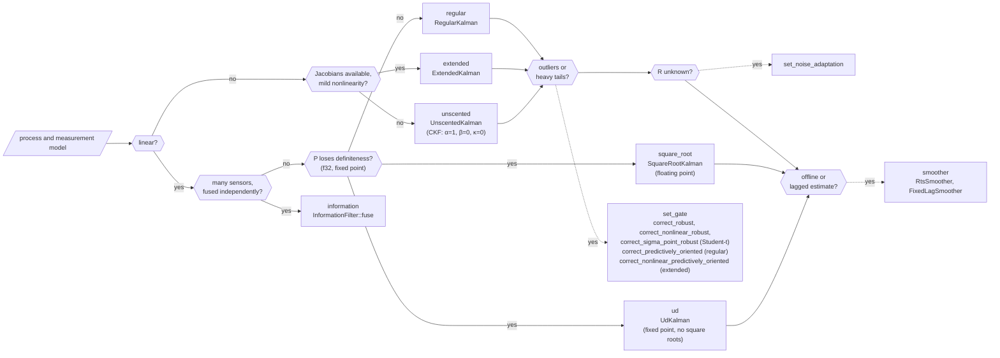
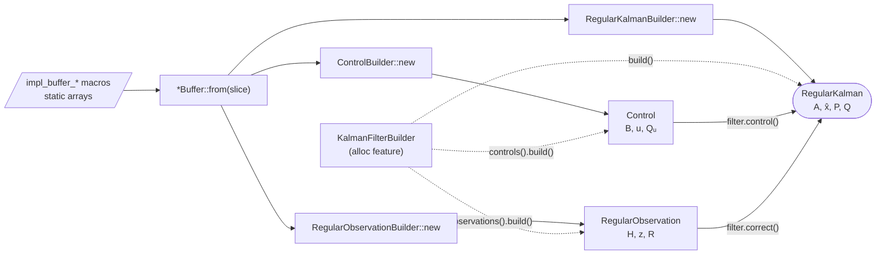

# Kalman Filters for Embedded Targets (in Rust)

[](https://crates.io/crates/minikalman)
[](https://crates.io/crates/minikalman)

[](https://docs.rs/minikalman/)
[](https://codecov.io/gh/sunsided/minikalman-rs)

This is the Rust port of my [kalman-clib](https://github.com/sunsided/kalman-clib/) library, a microcontroller targeted
Kalman filter implementation, as well as the
[libfixkalman](https://github.com/sunsided/libfixkalman) C library for Q16.16 fixed-point Kalman filters. It optionally
uses [`micromath`](https://docs.rs/micromath)
for square root calculations on `no_std`, and can use [`libm`](https://docs.rs/libm) if wished for.
Depending on the configuration, this crate may require `f32` / FPU support.

This implementation uses statically allocated buffers for all matrix operations. Due to lack
of `const` generics for array allocations in Rust, this crate also provides helper macros
to create the required arrays.

Try it in the browser: the [live demo](https://sunsided.github.io/minikalman-rs/) runs the Extended and
Unscented Kalman filters, compiled to WebAssembly, side by side on a radar tracking problem.

<div align="center">
    
</div>

## Which filter do I need?

Pick the filter from the model, then add what the measurements need: an innovation gate, the
Student-t robust correction or the predictively oriented correction against outliers, noise
adaptation when `R` is unknown, and a smoother when the estimate may lag behind the
measurements.



## `no_std` vs `std`, `alloc`

This crate builds as `no_std` by default. To build with `std` support, run:

```shell
cargo build --features=std
```

Independently of `std` you can turn on `alloc` features. This enables simplified builders with heap-allocated buffers:

```shell
cargo build --features=alloc
```

## Examples

In the order of [Which filter do I need?](#which-filter-do-i-need):

- [Regular filter](#targets-with-allocations-std-or-alloc) for linear models
- [Information filter](#information-filter-fusing-sensors) for fusing many independent sensors
- [UD filter](#ud-filter) for fixed-point or ill-conditioned problems
- [Extended Kalman filter](#extended-kalman-filters) for nonlinear models with Jacobians
- [Unscented Kalman filter](#unscented-kalman-filter) for nonlinear models without Jacobians
- [Robust corrections](#robust-corrections-gating-and-noise-adaptation): NIS gate, predictively
  oriented correction, noise adaptation, covariance update form
- [Angle wrapping](#angle-wrapping) for headings and bearings
- [Smoothing](#smoothing-a-recorded-run) a recorded run
- [Embedded targets](#embedded-targets), [fixed-point](#q1616-fixed-point) and the
  [gravity](#gravity-constant-estimation-example) example

Each step of the regular filter predicts, applies the optional control, and corrects with
each measurement.


Filters, controls and observations own their matrices as buffers. On embedded targets, the
`impl_buffer_*` macros create them as static arrays; with `alloc`, the builders allocate them:



### Targets with allocations (`std` or `alloc`)

When the `alloc` crate feature is enabled either directly or implicitly via `std`,
some builders are enabled that allow for simple creation of filters. This should help non-embedded use cases, or any
use case that does not have to explicitly manage buffer locations, to get an easier start:

```rust
# use minikalman::prelude::*;
# use minikalman::regular;
#
const NUM_STATES: usize = 3;
const NUM_CONTROLS: usize = 2;
const NUM_OBSERVATIONS: usize = 1;

# #[cfg(feature = "alloc")]
fn example() {
    let builder = regular::builder::KalmanFilterBuilder::<NUM_STATES, f32>::default();
    let mut filter = builder.build();
    let mut control = builder.controls().build::<NUM_CONTROLS>();
    let mut measurement = builder.observations().build::<NUM_OBSERVATIONS>();

    // Set up the system dynamics, control matrices, observation matrices, ...

    // Filter!
    loop {
        // Update your control vector(s).
        control.control_vector_mut().apply(|u| {
            u[0] = 0.0;
            u[1] = 1.0;
        });

        // Update your measurement vectors.
        measurement.measurement_vector_mut().apply(|z| {
            z[0] = 42.0;
        });

        // Update prediction (without controls).
        filter.predict();

        // Apply any controls to the prediction.
        filter.control(&mut control);

        // Apply any measurements.
        filter.correct(&mut measurement);

        // Access the state
        let state = filter.state_vector();
        let covariance = filter.estimate_covariance();
    }
}
```

### Information filter: fusing sensors

The information filter keeps `Y = P⁻¹` and `ŷ = P⁻¹·x̂` instead of `x̂` and `P`. Each sensor
then adds its information, `Y ← Y + Hᵀ·R⁻¹·H`, in any order and without inverting `Y`. Use it
when many independent sensors report at once, or when the start is truly unknown (`Y = 0`):

```rust
# #[cfg(feature = "alloc")] {
use minikalman::prelude::*;
use minikalman::regular::builder::KalmanFilterBuilder;

// Position and velocity; the filter starts with no information at all (Y = 0).
let builder = KalmanFilterBuilder::<2, f32>::default();
let mut filter = builder.build_information();
filter.state_transition_mut().apply(|a| {
    a.set(0, 0, 1.0);
    a.set(0, 1, 0.1);
    a.set(1, 1, 1.0);
});
filter.process_noise_mut().set(1, 1, 0.01);

let mut gps = builder.observations().build::<1>();
gps.observation_matrix_mut().set(0, 0, 1.0);
gps.measurement_noise_covariance_mut().set(0, 0, 4.0);

let mut wheel_speed = builder.observations().build::<1>();
wheel_speed.observation_matrix_mut().set(0, 1, 1.0);
wheel_speed.measurement_noise_covariance_mut().set(0, 0, 0.25);

for (position, speed) in [(0.1, 1.0), (0.2, 1.1), (0.35, 0.9), (0.4, 1.0)] {
    gps.measurement_vector_mut().set(0, 0, position);
    wheel_speed.measurement_vector_mut().set(0, 0, speed);
    assert!(filter.fuse(&mut gps));
    assert!(filter.fuse(&mut wheel_speed));
    assert!(filter.predict());
}

// Recover x̂ = Y⁻¹·ŷ and P = Y⁻¹ when needed; this costs one inversion.
let mut x = BufferBuilder::state_vector_x::<2>().new();
let mut p = BufferBuilder::estimate_covariance_P::<2>().new();
assert!(filter.state(&mut x, &mut p));
assert!(x.get(1, 0) > 0.5 && p.get(0, 0) < 4.0);
# }
```

`predict` and `state` invert `Y`, so they return `false` while some state is still unobserved.
The [`information_filter`](https://github.com/sunsided/minikalman-rs/blob/main/crates/minikalman/tests/information_filter.rs)
test compares it step by step to the regular filter.

### UD filter

`ud::UdKalman` is a linear filter that keeps `P` factored as `U·D·Uᵀ`, which stays positive
semi-definite whatever rounding does, and never takes a square root. Use it on fixed-point
targets (e.g. `I16F16`) or for ill-conditioned problems where the plain filter's `P` turns
indefinite:

```rust
# #[cfg(feature = "alloc")] {
use minikalman::prelude::*;
use minikalman::regular::builder::KalmanFilterBuilder;

// The prediction workspace is 2 × STATES wide.
let builder = KalmanFilterBuilder::<2, f32>::default();
let mut filter = builder.build_ud::<4>();
let mut gps = builder.observations().build::<1>();
filter.state_transition_mut().apply(|a| {
    a.set(0, 0, 1.0);
    a.set(0, 1, 0.1);
    a.set(1, 1, 1.0);
});

// Q and the initial P are given in full and factored once.
let mut q = BufferBuilder::direct_process_noise_covariance_Q::<2>().new();
q.set(1, 1, 0.01);
assert!(filter.set_process_noise(&q));
let mut x = BufferBuilder::state_vector_x::<2>().new();
let mut p = BufferBuilder::estimate_covariance_P::<2>().new();
p.make_identity();
assert!(filter.set_state(&x, &p));

gps.observation_matrix_mut().set(0, 0, 1.0);
gps.measurement_noise_covariance_mut().set(0, 0, 4.0);
for z in [0.1, 0.25, 0.3, 0.45] {
    filter.predict();
    gps.measurement_vector_mut().set(0, 0, z);
    assert!(filter.correct(&mut gps).is_applied());
}

// Multiply the factors back out into x̂ and P.
filter.state(&mut x, &mut p);
assert!(p.get(0, 0) > 0.0 && p.get(0, 0) < 1.0);
# }
```

The [`ud`](https://docs.rs/minikalman/latest/minikalman/ud/index.html) module docs give the
value ranges that fit `I16F16`.

### Extended Kalman Filters

The general setup remains the same, however the `predict` and `correct` methods are
replaced with their nonlinear counterparts:

```rust
# use minikalman::prelude::*;
# use minikalman::extended;
# use rand_distr::{Distribution, Normal};
#
const NUM_STATES: usize = 3;
const NUM_OBSERVATIONS: usize = 1;

# #[cfg(feature = "alloc")]
fn example() {
    let builder = extended::builder::KalmanFilterBuilder::<NUM_STATES, f32>::default();
    let mut filter = builder.build();
    let mut measurement = builder.observations().build::<NUM_OBSERVATIONS>();

    // The time step of our simulation.
    const DELTA_T: f32 = 0.1;

    // Set up the initial state vector.
    filter.state_vector_mut().apply(|vec| {
        vec.set_row(0, 0.0);
        vec.set_row(1, 0.0);
        vec.set_row(2, 1.0);
        vec.set_row(3, 1.0);
    });

    // Set up the initial estimate covariance as an identity matrix.
    filter.estimate_covariance_mut().make_identity();

    // Set up the process noise covariance matrix as an identity matrix.
    measurement
        .measurement_noise_covariance_mut()
        .make_scalar(1.0);

    // Set up the measurement noise covariance.
    measurement.measurement_noise_covariance_mut().apply(|mat| {
        mat.set_value(1.0); // matrix is 1x1
    });

    // Simulate
    for step in 1..=100 {
        let time = step as f32 * DELTA_T;

        // Update the system transition Jacobian matrix.
        filter.state_transition_jacobian_mut().apply(|mat| {
            mat.make_identity();
            mat.set(0, 2, DELTA_T);
            mat.set(1, 3, DELTA_T);
        });

        // Perform a nonlinear prediction step.
        filter.predict_nonlinear(|state, next| {
            // Simple constant velocity model.
            next[0] = state[0] + state[2] * DELTA_T;
            next[1] = state[1] + state[3] * DELTA_T;
            next[2] = state[2];
            next[3] = state[3];
        });

        // Prepare a measurement.
        measurement.measurement_vector_mut().apply(|vec| {
            // Noise setup.
            let mut rng = rand::thread_rng();
            let measurement_noise = Normal::new(0.0, 0.5).unwrap();

            // Perform a noisy measurement of the (simulated) position.
            let z = (time.powi(2) + time.powi(2)).sqrt();
            let noise = measurement_noise.sample(&mut rng);

            vec.set_value(z + noise);
        });

        // Update the observation Jacobian.
        measurement.observation_jacobian_matrix_mut().apply(|mat| {
            let x = filter.state_vector().get_row(0);
            let y = filter.state_vector().get_row(1);

            let norm = (x.powi(2) + y.powi(2)).sqrt();
            let dx = x / norm;
            let dy = y / norm;

            mat.set_col(0, dx);
            mat.set_col(1, dy);
            mat.set_col(2, 0.0);
            mat.set_col(3, 0.0);
        });

        // Apply nonlinear correction step.
        filter.correct_nonlinear(&mut measurement, |state, observation| {
            // Transform the state into an observation.
            let x = state.get_row(0);
            let y = state.get_row(1);
            let z = (x.powi(2) + y.powi(2)).sqrt();
            observation.set_value(z);
        });
    }
}
```

For a slightly more realistic EKF example that simulates radar measurements of a moving object,
see the [`radar-2d`](https://github.com/sunsided/minikalman-rs/blob/main/crates/minikalman/examples/radar_2d.rs) example.

```shell
cargo run --example radar-2d --features=std
```

### Unscented Kalman Filter

The unscented filter propagates `2n + 1` sigma points through the nonlinear `f` and `h`
themselves, so it needs no Jacobians and copes with stronger nonlinearity than the EKF. Here,
a pendulum's angle and angular rate are tracked from the bob's horizontal position:

```rust
# #[cfg(feature = "alloc")] {
use minikalman::prelude::*;
use minikalman::unscented::builder::KalmanFilterBuilder;

const NUM_STATES: usize = 2; // angle θ (rad), angular rate ω (rad/s)
const NUM_SIGMA: usize = 2 * NUM_STATES + 1;
const DT: f32 = 0.05;
const G_OVER_L: f32 = 9.81; // a pendulum of length 1 m

let builder = KalmanFilterBuilder::<NUM_STATES, f32>::default();
let mut filter = builder.build::<NUM_SIGMA>();
let mut bob = builder.observations().build::<1, NUM_SIGMA>();

// Cubature Kalman filter weights: all positive, no centre point.
filter.set_alpha(1.0);
filter.set_beta(0.0);
filter.set_kappa(0.0);

filter.state_vector_mut().set_at(0, 0, 0.2);
filter.estimate_covariance_mut().make_scalar(0.1);
filter.direct_process_noise_mut().make_scalar(1e-4);
bob.measurement_noise_covariance_mut().make_scalar(1e-3);

for step in 1..=100 {
    // f is applied to every sigma point.
    filter.predict_nonlinear(|x| {
        let (theta, omega) = (x.as_matrix().get_at(0, 0), x.as_matrix().get_at(1, 0));
        x.as_matrix_mut().set_at(0, 0, theta + omega * DT);
        x.as_matrix_mut().set_at(1, 0, omega - G_OVER_L * theta.sin() * DT);
    });

    let truth = 0.3 * (G_OVER_L.sqrt() * step as f32 * DT).cos();
    bob.measurement_vector_mut().set_at(0, 0, truth.sin());

    // h maps each predicted sigma point (column j of a STATES × NUM_SIGMA matrix).
    filter.correct_sigma_point(&mut bob, |sigma, observed| {
        for j in 0..NUM_SIGMA {
            observed[j] = sigma[j].sin();
        }
    });
}

let truth = 0.3 * (G_OVER_L.sqrt() * 100.0 * DT).cos();
assert!((filter.state_vector().get_at(0, 0) - truth).abs() < 0.05);
# }
```

The builder defaults to `α = 1`, `β = 2`, `κ = 1`; the cubature settings above are often the
better choice under strong nonlinearity. See the
[`UnscentedKalman`](https://docs.rs/minikalman/latest/minikalman/unscented/struct.UnscentedKalman.html)
docs for how the parameters place and weight the sigma points, and the
[`radar-2d-ukf`](https://github.com/sunsided/minikalman-rs/blob/main/crates/minikalman/examples/radar_2d_ukf.rs)
and [`radar_2d_ukf_builder`](https://github.com/sunsided/minikalman-rs/blob/main/crates/minikalman/examples/radar_2d_ukf_builder.rs)
examples for a range-bearing tracker.

### Robust corrections: gating and noise adaptation

Each observation can reject outliers and learn its own noise. Use the gate when readings are
occasionally wrong, the predictively oriented correction when the noise is heavy-tailed, and
noise adaptation when `R` is not known in advance:

```rust
# #[cfg(feature = "alloc")] {
use minikalman::prelude::*;
use minikalman::regular::builder::KalmanFilterBuilder;
use minikalman::regular::CovarianceUpdate;

let builder = KalmanFilterBuilder::<1, f32>::default();
let mut filter = builder.build();
let mut sensor = builder.observations().build::<1>();
filter.state_transition_mut().make_identity();
filter.direct_process_noise_mut().make_scalar(0.01);
filter.estimate_covariance_mut().make_scalar(1.0);
sensor.observation_matrix_mut().make_identity();
sensor.measurement_noise_covariance_mut().make_scalar(1.0);

// Skip readings whose NIS = yᵀ·S⁻¹·y exceeds the 99% χ² quantile for one measurement.
sensor.set_gate(Some(6.63));
// Learn R from the residuals, forgetting old ones with α = 0.95.
sensor.set_noise_adaptation(Some(NoiseAdaptation { forgetting: 0.95, floor: 0.01 }));

for z in [0.2, -0.1, 0.1, 50.0, 0.0] {
    filter.predict();
    sensor.measurement_vector_mut().set_at(0, 0, z);
    let status = filter.correct(&mut sensor);
    assert_eq!(status == CorrectionStatus::Gated, z == 50.0);
}

// Instead of a hard gate, the predictively oriented correction down-weights large
// innovations; it takes a budget of Newton steps and scalar observations.
sensor.set_gate(None);
sensor.measurement_vector_mut().set_at(0, 0, 8.0);
assert!(filter.correct_predictively_oriented(&mut sensor, 20).is_applied());

// The Joseph form keeps P symmetric and is the default. Opt into the cheaper
// P ← P − K·H·P only where its extra products do not fit the budget.
sensor.set_covariance_update(CovarianceUpdate::Standard);
# }
```

The same `set_gate` and `set_noise_adaptation` exist on extended and unscented observations;
the extended filter has `correct_nonlinear_predictively_oriented`, and all three have a
Student-t robust correction (`correct_robust` and its nonlinear variants). The
[`numerical_robustness`](https://github.com/sunsided/minikalman-rs/blob/main/crates/minikalman/tests/numerical_robustness.rs)
test bench measures what the Joseph form buys.

### Angle wrapping

A heading of `3.1` rad and a reading of `−3.1` rad are `0.08` rad apart, not `6.2`. Wrap the
innovation with `correct_with`, and keep the state itself wrapped, whenever a state or
measurement is an angle:

```rust
# #[cfg(feature = "alloc")] {
use minikalman::angles::wrap_pi;
use minikalman::prelude::*;
use minikalman::regular::builder::KalmanFilterBuilder;

let builder = KalmanFilterBuilder::<1, f32>::default();
let mut filter = builder.build();
let mut compass = builder.observations().build::<1>();
filter.state_transition_mut().make_identity();
filter.estimate_covariance_mut().make_identity();
compass.observation_matrix_mut().make_identity();
compass.measurement_noise_covariance_mut().make_identity();

// The heading is just below +π; the compass reads just above −π.
filter.state_vector_mut().set_at(0, 0, 3.1);
compass.measurement_vector_mut().set_at(0, 0, -3.1);

filter.predict();
filter.correct_with(&mut compass, |y| y[0] = wrap_pi(y[0]));
filter.state_vector_mut().apply(|x| x.set(0, 0, wrap_pi(x.get(0, 0))));

// The estimate moves across ±π, not 3.1 rad the long way round.
assert!(filter.state_vector().get_at(0, 0).abs() > 3.1);
# }
```

`angles::wrap_180` does the same in degrees; both work with fixed-point types. The
[`compass`](https://github.com/sunsided/minikalman-rs/blob/main/crates/minikalman/examples/compass.rs)
example runs a wrapped and an unwrapped filter side by side:

```shell
cargo run --example compass --features=std
```

### Smoothing a recorded run

The RTS smoother refines every filtered estimate of a recorded run with the measurements
that came after it. Record the predicted values after `predict()` and the filtered ones after
`correct()`, then smooth in place:

```rust
# #[cfg(feature = "alloc")] {
use minikalman::matrix::MatrixDataArray;
use minikalman::models::motion;
use minikalman::prelude::*;
use minikalman::regular::builder::KalmanFilterBuilder;
use minikalman::smoother::RtsSmoother;

type Vector = MatrixDataArray<2, 1, 2, f32>;
type Square = MatrixDataArray<2, 2, 4, f32>;

let builder = KalmanFilterBuilder::<2, f32>::default();
let mut filter = builder.build();
let mut measurement = builder.observations().build::<1>();
let model = motion::constant_velocity(1.0, 0.1);
filter.state_transition_mut().apply(|a| model.fill_transition(a));
filter.direct_process_noise_mut().apply(|q| model.fill_process_noise(q));
filter.estimate_covariance_mut().make_scalar(10.0);
measurement.observation_matrix_mut().set(0, 0, 1.0);
measurement.measurement_noise_covariance_mut().set(0, 0, 1.0);

let readings = [0.1, 1.2, 1.9, 3.1, 3.8, 5.3];
let mut x = vec![Vector::new([0.0; 2]); readings.len()];
let mut p = vec![Square::new([0.0; 4]); readings.len()];
let (mut x_predicted, mut p_predicted) = (x.clone(), p.clone());

for (k, z) in readings.into_iter().enumerate() {
    filter.predict();
    filter.state_vector().inspect(|v| v.copy_to(&mut x_predicted[k]));
    filter.estimate_covariance().inspect(|m| m.copy_to(&mut p_predicted[k]));
    measurement.measurement_vector_mut().set(0, 0, z);
    filter.correct(&mut measurement);
    filter.state_vector().inspect(|v| v.copy_to(&mut x[k]));
    filter.estimate_covariance().inspect(|m| m.copy_to(&mut p[k]));
}

let mut smoother = RtsSmoother::new(
    Square::new([0.0; 4]),
    Square::new([0.0; 4]),
    Square::new([0.0; 4]),
    Vector::new([0.0; 2]),
);
let smoothed = filter
    .state_transition()
    .inspect(|a| smoother.smooth(a, &mut x, &mut p, &x_predicted, &p_predicted));
assert!(smoothed);
# }
```

For online use, `smoother::FixedLagSmoother` runs the same pass over a ring buffer of the last
`N` steps and yields each step smoothed with the `N − 1` steps after it. The
[`smoother`](https://docs.rs/minikalman/latest/minikalman/smoother/index.html) module docs
show both.

### Embedded Targets

An example for STM32F303 microcontrollers can be found in the
[`xbuild-tests/stm32`] directory. It showcases both fixed-point and floating-point support.

### `Q16.16` fixed-point

Run the `fixed` example with the `fixed` crate feature. This enables `I16F16` type support, similar to
the [libfixkalman](https://github.com/sunsided/libfixkalman) C library.

```shell
cargo run --example fixed --features=fixed
```

### Gravity Constant Estimation Example

To run the example [`gravity`] simulation, run either

```shell
cargo run --example gravity --features=std
cargo run --example gravity --features=std,libm
```

This will estimate the (earth's) gravitational constant (g ≈ 9.807 m/s²) through observation
of the position of a free-falling object. When executed, it should print something along the lines of:

```text
At t = 0, predicted state: s = 3 m, v = 6 m/s, a = 6 m/s²
At t = 0, measurement: s = 0 m, noise ε = 0.13442 m
At t = 0, corrected state: s = 0.908901 m, v = 3.6765568 m/s, a = 5.225519 m/s²
At t = 1, predicted state: s = 7.1982174 m, v = 8.902076 m/s, a = 5.225519 m/s²
At t = 1, measurement: s = 4.905 m, noise ε = 0.45847 m
At t = 1, corrected state: s = 5.6328573 m, v = 7.47505 m/s, a = 4.5993752 m/s²
At t = 2, predicted state: s = 15.407595 m, v = 12.074425 m/s, a = 4.5993752 m/s²
At t = 2, measurement: s = 19.62 m, noise ε = -0.56471 m
At t = 2, corrected state: s = 18.50683 m, v = 14.712257 m/s, a = 5.652767 m/s²
At t = 3, predicted state: s = 36.04547 m, v = 20.365025 m/s, a = 5.652767 m/s²
At t = 3, measurement: s = 44.145 m, noise ε = 0.21554 m
At t = 3, corrected state: s = 42.8691 m, v = 25.476515 m/s, a = 7.3506646 m/s²
At t = 4, predicted state: s = 72.02094 m, v = 32.82718 m/s, a = 7.3506646 m/s²
At t = 4, measurement: s = 78.48 m, noise ε = 0.079691 m
At t = 4, corrected state: s = 77.09399 m, v = 36.10087 m/s, a = 8.258889 m/s²
At t = 5, predicted state: s = 117.3243 m, v = 44.359756 m/s, a = 8.258889 m/s²
At t = 5, measurement: s = 122.63 m, noise ε = -0.32692 m
At t = 5, corrected state: s = 120.94025 m, v = 46.38022 m/s, a = 8.736543 m/s²
At t = 6, predicted state: s = 171.68874 m, v = 55.11676 m/s, a = 8.736543 m/s²
At t = 6, measurement: s = 176.58 m, noise ε = -0.1084 m
At t = 6, corrected state: s = 174.93135 m, v = 56.704926 m/s, a = 9.062785 m/s²
At t = 7, predicted state: s = 236.16766 m, v = 65.76771 m/s, a = 9.062785 m/s²
At t = 7, measurement: s = 240.35 m, noise ε = 0.085656 m
At t = 7, corrected state: s = 238.87048 m, v = 66.942894 m/s, a = 9.276019 m/s²
At t = 8, predicted state: s = 310.4514 m, v = 76.21891 m/s, a = 9.276019 m/s²
At t = 8, measurement: s = 313.92 m, noise ε = 0.8946 m
At t = 8, corrected state: s = 313.03793 m, v = 77.22877 m/s, a = 9.44006 m/s²
At t = 9, predicted state: s = 394.98672 m, v = 86.66882 m/s, a = 9.44006 m/s²
At t = 9, measurement: s = 397.31 m, noise ε = 0.69236 m
At t = 9, corrected state: s = 396.6648 m, v = 87.26297 m/s, a = 9.527418 m/s²
At t = 10, predicted state: s = 488.69147 m, v = 96.79039 m/s, a = 9.527418 m/s²
At t = 10, measurement: s = 490.5 m, noise ε = -0.33747 m
At t = 10, corrected state: s = 489.46213 m, v = 97.03994 m/s, a = 9.560934 m/s²
At t = 11, predicted state: s = 591.28253 m, v = 106.600876 m/s, a = 9.560934 m/s²
At t = 11, measurement: s = 593.51 m, noise ε = 0.75873 m
At t = 11, corrected state: s = 592.75964 m, v = 107.04147 m/s, a = 9.615404 m/s²
At t = 12, predicted state: s = 704.6088 m, v = 116.656876 m/s, a = 9.615404 m/s²
At t = 12, measurement: s = 706.32 m, noise ε = 0.18135 m
At t = 12, corrected state: s = 705.4952 m, v = 116.90193 m/s, a = 9.643473 m/s²
At t = 13, predicted state: s = 827.2188 m, v = 126.5454 m/s, a = 9.643473 m/s²
At t = 13, measurement: s = 828.94 m, noise ε = -0.015764 m
At t = 13, corrected state: s = 827.97705 m, v = 126.74077 m/s, a = 9.66432 m/s²
At t = 14, predicted state: s = 959.55 m, v = 136.40509 m/s, a = 9.66432 m/s²
At t = 14, measurement: s = 961.38 m, noise ε = 0.17869 m
At t = 14, corrected state: s = 960.39984 m, v = 136.6101 m/s, a = 9.684802 m/s²
```

[`gravity`]: https://github.com/sunsided/minikalman-rs/tree/main/crates/minikalman/examples/gravity.rs

[`xbuild-tests/stm32`]: https://github.com/sunsided/minikalman-rs/tree/main/xbuild-tests/stm32

## Testing & Fuzzing

### Property-based tests (stable)

```shell
# Run all tests (default features)
cargo test -p minikalman

# Run property-based tests (requires std)
cargo test -p minikalman --features std --test proptest_matrix
cargo test -p minikalman --features std --test proptest_filter

# Run with no_std-compatible features only
cargo test -p minikalman --no-default-features --features libm,alloc
```

### Conformance suite

The conformance suite checks that the filters compute what the math says. It compares them
against reference vectors from an independent NumPy/SciPy implementation, against analytic
identities (for example, the EKF equals the KF on a linear model, and the RTS smoother equals
the batch least-squares solution), and against chi-square bounds on NEES and NIS over Monte
Carlo runs. It also checks invariants and regression baselines, with stated tolerances for
`f64`, `f32`, `I32F32` and `I16F16`. Run it to convince yourself the crate works, and see
[`tests/conformance/README.md`] for what each check proves and how to regenerate the
references.

```shell
cargo test -p minikalman --test conformance --features std,fixed
cargo test -p minikalman --test conformance --no-default-features --features libm,alloc
cargo test -p minikalman --test conformance --no-default-features --features micromath,alloc
# or all three:
task conformance
```

[`tests/conformance/README.md`]: https://github.com/sunsided/minikalman-rs/tree/main/crates/minikalman/tests/conformance/README.md

### Fuzzing (nightly)

Fuzz targets require a nightly toolchain and `cargo-fuzz`. They live under
`crates/minikalman/fuzz/` and are excluded from the workspace.

```shell
# Install cargo-fuzz (once)
cargo +nightly install cargo-fuzz

# Run individual fuzz targets
cd crates/minikalman/fuzz
cargo +nightly fuzz run matrix_cholesky
cargo +nightly fuzz run matrix_mult
cargo +nightly fuzz run regular_filter
cargo +nightly fuzz run extended_filter -- -max_total_time=60
```
